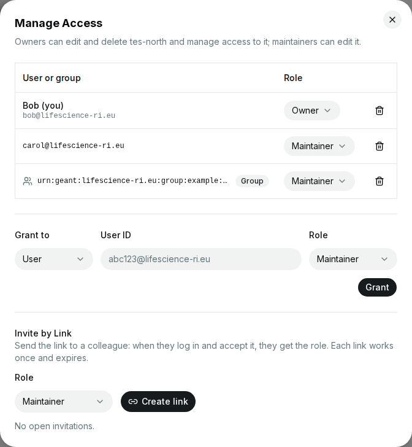
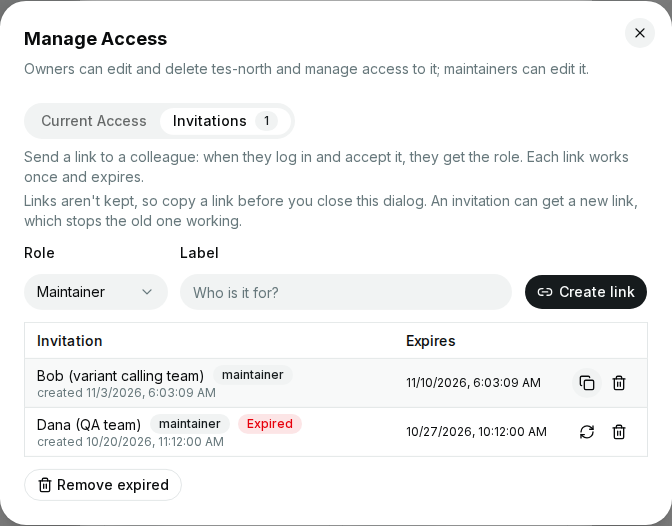

# Access and permissions

Everyone can see the approved services and service types, unless the
deployment requires a login for that. What else you can do depends on
your roles:

| Who                    | Can                                                                         |
| ---------------------- | --------------------------------------------------------------------------- |
| Everyone               | browse services and service types                                           |
| Logged-in users        | register services, and add service types if the deployment allows it       |
| Maintainers of a service | edit it                                                                   |
| Owners of a service    | edit and delete it, and manage access to it                                |
| Admins, in admin mode  | everything, e.g. verify services and approve service types (see [Admin mode](admin-mode.md)) |

You become the owner of the services you register. Owners can give other
users, or groups, a role on their services: e.g. a colleague who updates
the service, or the team that runs it.

**My services** above the list of services shows only the services on
which you have a role, yourself or through a group (see [Searching and
filtering](browsing.md#searching-and-filtering)).

Which groups make users admins, and which groups exist, depends on the
deployment and its login provider; your deployment's documentation says
whom to ask.

## Managing access

Owners of a service, and admins, can see and change who has which role on
it. This needs a registry newer than cloud-registry 1.0.0rc1 (see
[Compatibility](../operator-guide/index.md#compatibility)); 0.6.0 and 1.0.0rc1
give roles to the wrong user:

1. Open the service and select **Manage access**. The dialog has two tabs:
   **Current Access**, described here, and **Invitations** (see [Inviting
   by link](#inviting-by-link)).
2. The list shows the users and groups with a role, also those who joined
   through an invitation: users by name and user ID once they have used the
   registry (before, by user ID only), groups by their name in the login
   provider. Long lists show 5 entries per page, unless the deployment sets
   another number, with a search above them that finds users and groups by
   name, user ID, group or role.
3. Change a role in the list, or remove it with the bin icon.
4. To grant a role, choose **User** or **Group** under **Grant to**, enter
   the user ID or the group, choose the role and select **Grant**.

{ width="672" }

The roles are:

- **Owner**: can edit and delete the service, and manage access to it.
- **Maintainer**: can edit the service, but not delete it, nor manage
  access to it.

Notes:

- **User IDs:** ask the other user for their user ID: it is shown in the
  menu at the bottom of the sidebar (see [Your user
  ID](index.md#your-user-id)). It is not their name or email address.
- **Groups:** all members of a group get its role, and members of an owner
  group can manage access to the service. Grant roles only to the groups of
  your team, never to broad groups. Owners can grant roles to groups they
  are members of.
- **The last owner** can't be removed, nor made a maintainer: grant another
  owner first, or delete the service.
- **Your own role:** if you remove your own owner role, you can no longer
  manage access, and the dialog closes.
- **User IDs and groups** may contain slashes, though not start with one, and
  can't have the parts `.` or `..` (e.g. `a/../b`). User IDs may be `groups` or
  start with `groups/`: the app and the registry keep them apart from groups.

## Inviting by link

Instead of asking for a user ID, owners of a service, and admins, can
invite a colleague with a link:

1. Open the service, select **Manage access**, and open the **Invitations**
   tab, which shows the number of open invitations.
2. Choose the role the invitation is for, enter a label that says who it is
   for, e.g. `Bob (variant calling team)`, and select **Create link**. The
   new invitation is at the top of the list.
3. Copy the link with the copy icon in its row, and send it to the person.

{ width="672" }

Notes:

- **Labels** tell you which link is whose, so that you send the right one.
  They are for those who manage access: the person who gets the link doesn't
  see the label. Labels are plain text of at most 100 characters on one
  line, so don't put more in them than needed, as they may name people. The
  deployment decides whether a label is required; by default, it is.
  Invitations without one, e.g. older ones, show **No label**.
- **Links aren't kept:** the registry keeps no copy of a link, so the copy
  icon is there only while the dialog is open, for the invitations created
  in it. Copy a link before you close the dialog; if copying fails, the
  dialog shows the link for you to select. Afterwards, an invitation can
  only get a new link: select the arrows icon (**New link**) in its row.
  This creates an invitation for the same role and with the same label, at
  the top of the list, and revokes the old one, whose link then stops
  working.
- **If the list can't be loaded,** the dialog says so and lists only the
  invitations created in it, so that you can still copy their links. Reopen
  the dialog later to revoke invitations or create new ones; the links of
  invitations you copied keep working.
- **Share it only with the person you mean:** whoever opens the link and
  logs in gets the role, and the link works once. Send it in a private
  message, not in a channel or on a page that others can read.
- **The list** shows the open and the expired invitations, newest first
  (label, role, when created and when they expire), 5 per page unless the
  deployment sets another number. Long labels are cut off: point at one to see
  all of it, which touch screens don't offer. On phones, the expiry is under
  the label. Select the bin icon to revoke an open invitation; its link then
  stops working. Accepted invitations aren't listed: the person is listed under
  **Current Access**, where you can change or remove their role. If someone
  accepts while the dialog is open, they appear there when you select that tab
  again.
- **Expired invitations** are marked as **Expired**, so that you can see who
  didn't accept in time. Select **New link** to invite the person again,
  which removes the expired invitation, or the bin icon to remove it. To
  remove all expired invitations of the service, on all pages, select
  **Remove expired** and confirm. If some can't be removed, the dialog says
  which and they stay listed; select **Remove expired** to try again. The
  registry also removes expired invitations itself after some time, by
  default after 30 days.
- **Limits:** invitations expire, and a service can have only so many
  invitations at a time that haven't expired, open or accepted, so accepted
  invitations count until they expire although they aren't listed; expired
  ones don't count. If the limit is reached, the dialog says so and neither
  **Create link** nor **New link** makes a new invitation; a new link leaves
  the old invitation and its link as they are. Revoke open invitations or
  wait until invitations expire. The expiry and the limit are settings of
  the registry (see [Compatibility](../operator-guide/index.md#compatibility)).
- **A registry that is too old:** this version of the app needs a registry
  newer than cloud-registry 1.0.0rc1 (see
  [Compatibility](../operator-guide/index.md#compatibility)). Don't change the
  roles of users and ask your registry's admins to upgrade it if the dialog
  says so: if a grant reports that the role went to another user; if it
  creates a link without its label, as the registry has no labels, and
  invitations show **No label**; or if the tab reports that the registry has no
  invitations. The tab may also only say that it can't load them, which can have
  other causes.

The person who got the link follows [Accepting an
invitation](invitations.md).

