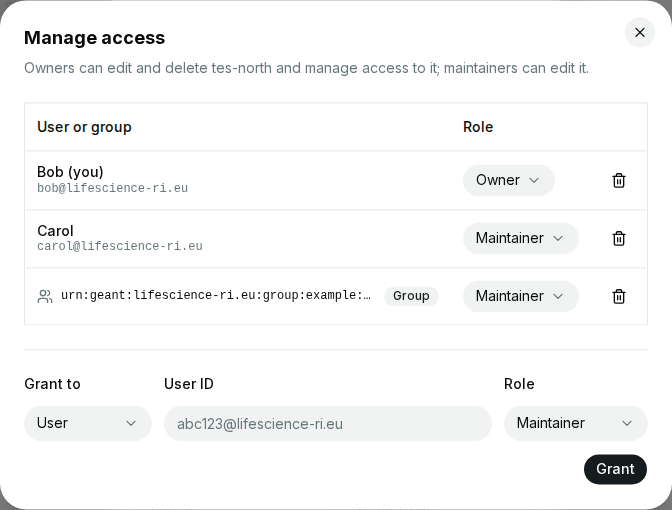
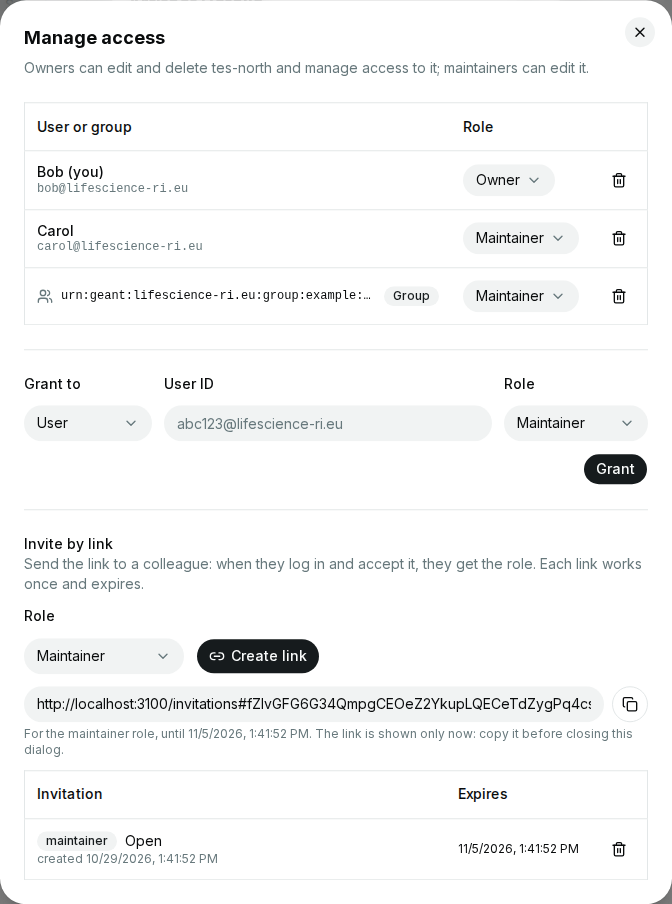

# Access and permissions

Everyone can see the approved services and service types, unless the
deployment requires a login for that. What else you can do depends on
your roles:

| Who                    | Can                                                                         |
| ---------------------- | --------------------------------------------------------------------------- |
| Everyone               | browse services and service types                                           |
| Logged-in users        | register services, and add service types if the deployment allows it       |
| Maintainers of a service | edit it                                                                   |
| Owners of a service    | edit and delete it, and manage access to it                                |
| Admins, in admin mode  | everything, e.g. verify services and approve service types (see [Admin mode](admin-mode.md)) |

You become the owner of the services you register. Owners can give other
users, or groups, a role on their services: e.g. a colleague who updates
the service, or the team that runs it.

Which groups make users admins, and which groups exist, depends on the
deployment and its login provider; your deployment's documentation says
whom to ask.

## Managing access

Owners of a service, and admins, can see and change who has which role on
it:

1. Open the service and select **Manage access**.
2. The list shows the users and groups with a role: users by name (once
   they have used the registry) and user ID, groups by their name in the
   login provider.
3. Change a role in the list, or remove it with the bin icon.
4. To grant a role, choose **User** or **Group** under **Grant to**, enter
   the user ID or the group, choose the role and select **Grant**.

{ width="672" }

The roles are:

- **Owner**: can edit and delete the service, and manage access to it.
- **Maintainer**: can edit the service, but not delete it, nor manage
  access to it.

Notes:

- **User IDs:** ask the other user for their user ID: it is shown in the
  menu at the bottom of the sidebar (see [Your user
  ID](index.md#your-user-id)). It is not their name or email address.
- **Groups:** all members of a group get its role, and members of an owner
  group can manage access to the service. Grant roles only to the groups of
  your team, never to broad groups. Owners can grant roles to groups they
  are members of.
- **The last owner** can't be removed, nor made a maintainer: grant another
  owner first, or delete the service.
- **Your own role:** if you remove your own owner role, you can no longer
  manage access, and the dialog closes.

## Inviting by link

Instead of asking for a user ID, owners of a service, and admins, can
invite a colleague with a link:

1. Open the service, select **Manage access**, and find **Invite by link**.
2. Choose the role the invitation is for, and select **Create link**.
3. Copy the link (the button next to it), and send it to the person.

{ width="672" }

Notes:

- **The link is shown once**, with the role and when it expires. Copy it
  before you close the dialog; if you lose it, revoke the invitation and
  create a new one.
- **Share it only with the person you mean:** whoever opens the link and
  logs in gets the role, and the link works once. Send it in a private
  message, not in a channel or on a page that others can read.
- **The list** below shows the open invitations (role, when created and
  when they expire) and the accepted ones (who accepted, and when), each
  only until its expiry: the registry then drops it from the list, accepted
  or not, and the role stays. Select
  the bin icon to revoke an open invitation; its link then stops working.
  An accepted invitation can't be revoked: remove the user's role instead
  (see [Managing access](#managing-access)).
- **Who is shown:** for the person who accepted, the list shows their name
  and email address as far as the registry knows them. The registry knows
  the email address only if the login provider marks it as verified;
  otherwise, only the name, or the user ID, is shown.
- **Limits:** invitations expire, and a service can have only so many open
  invitations at a time. If the limit is reached, revoke open invitations
  or wait until they expire. The expiry and the limit are settings of the
  registry (see [Compatibility](../operator-guide/index.md#compatibility)).
- **Registries without invitations:** the section reports that the registry
  has none, and you grant roles as above. Invitations need cloud-registry
  1.0.0-rc1 or later.

The person who got the link follows [Accepting an
invitation](invitations.md).

