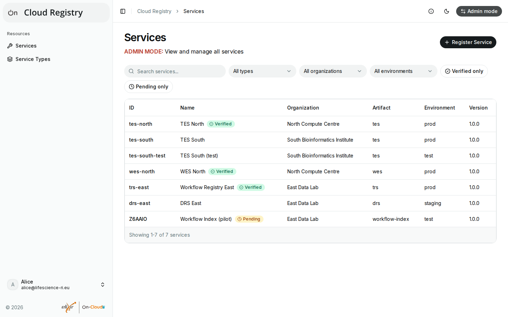
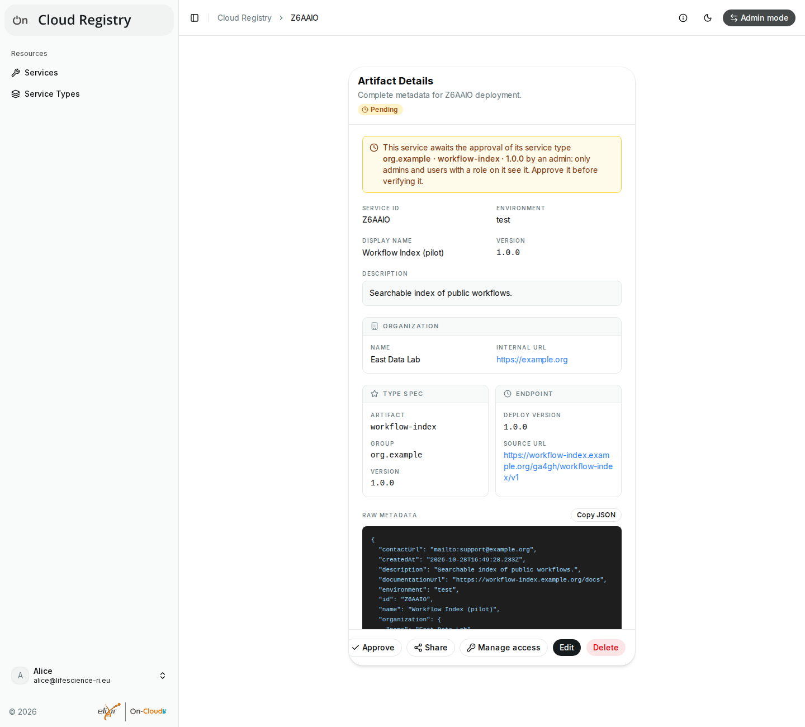

# Admin mode

Admins can do everything in the registry, e.g. edit and delete any
service, verify services and approve service types. So that this is a
deliberate choice, admins act as admins only in **admin mode**. Which
users are admins is decided by the deployment, usually by a group of its
login provider.

## Switching modes

Admins see a switch in the top bar:

- **User mode** (the default after logging in): you have the rights of
  other users, i.e. your roles on services.
- **Admin mode**: you have admin rights. The page titles say "ADMIN MODE".

Select the switch to change the mode. The mode lasts until you log out or
close the browser; logging in again starts in user mode.

If the switch turns red, your admin rights don't apply right now (e.g.
the registry can't be reached, or you are no longer in the admin group):
switch to user mode, or reload the page.

Deployments with registries before Cloud Registry 0.6.0, or that turned
admin mode off, show no switch: their admins always have admin rights.

## What admins can do

In admin mode, admins can:

- see all services and service types, also the pending ones, and filter
  the pending services (**Pending only**);
- approve pending service types, and so the services that have them (see
  [Pending entries](pending.md));
- verify services and remove verifications (see
  [Verifications](verifications.md));
- edit and delete any service, and manage access to it (see [Access and
  permissions](access.md));
- choose the ID of new services (**Advanced Configuration** of the form),
  and change the ID of existing services (edit form);
- add service types, which are approved at once, and remove service types
  that no service has (the bin icon on **Service Types**).

