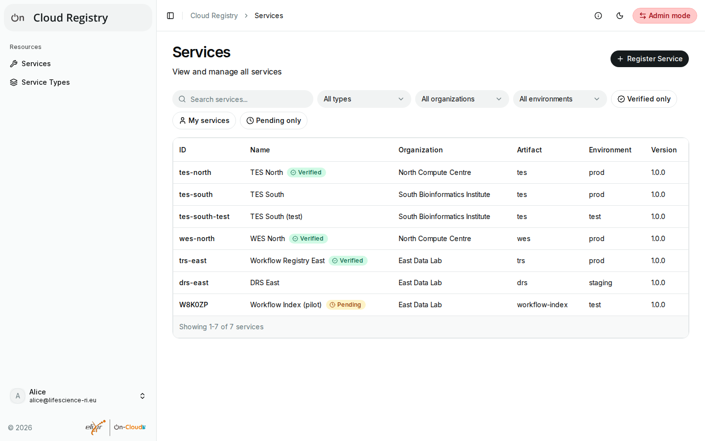
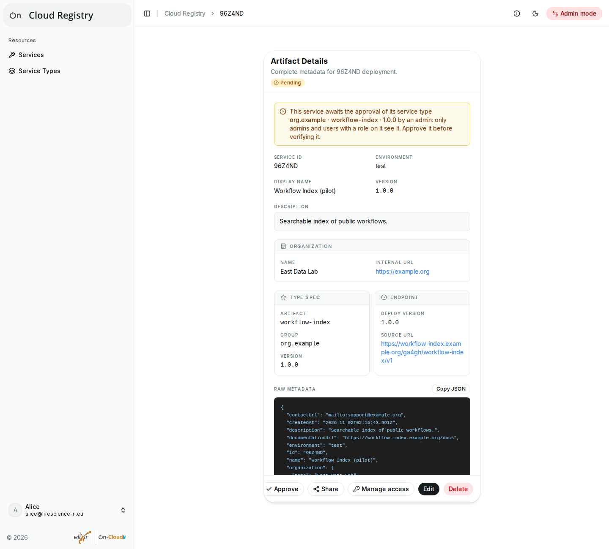

# Admin mode

Admins can do everything in the registry, e.g. edit and delete any
service, verify services and approve service types. So that this is a
deliberate choice, admins act as admins only in **admin mode**. Which
users are admins is decided by the deployment, usually by a group of its
login provider.

## Switching modes

Admins see a switch in the top bar:

- **User mode** (the default after logging in): you have the rights of
  other users, i.e. your roles on services.
- **Admin mode**: you have admin rights. The switch turns light red: it
  is the only sign of admin mode, so check it before you change anything.

Select the switch to change the mode. The mode lasts until you log out or
close the browser; logging in again starts in user mode.

If the switch turns amber and shows a warning sign, your admin rights
don't apply right now (e.g. the registry can't be reached, or you are no
longer in the admin group): switch to user mode, or reload the page.

Deployments with registries before Cloud Registry 0.6.0, or that turned
admin mode off, show no switch: their admins always have admin rights.

## What admins can do

In admin mode, admins can:

- see all services and service types, also the pending ones, and filter
  the pending services (**Pending only**);
- approve pending service types, and so the services that have them (see
  [Pending entries](pending.md));
- verify services and remove verifications (see
  [Verifications](verifications.md));
- edit and delete any service, and manage access to it (see [Access and
  permissions](access.md));
- choose the ID of new services (**Advanced Configuration** of the form),
  and change the ID of existing services (edit form);
- add service types, which are approved at once, and remove service types
  that no service has (the bin icon on **Service Types**);
- list the registry among its own services, or remove it (see [Listing the
  registry itself](#listing-the-registry-itself)).

## Listing the registry itself

The registry doesn't list itself among its services by default. In admin
mode, the service info page (the "i" icon in the top bar) has a section
**Service Listing**, where you can change that, so that clients find the
registry like any other service:

- **Add to services** adds the registry, and its service type if it is missing.
  The section then links to its entry.
- **Remove from services** removes the entry, roles on it, and its service
  type, unless other services have it.

**Services** and **Service Types** show the change the next time you open
them.

The registry builds its entry from its own service info and never syncs it, so
the entry's details say so instead of offering **Turn sync on**.

The registry builds the entry from its service info and its public URL. The
entry has no owner, doesn't count for any user's limit of services, and is
verified. While the registry is listed, it brings the entry up to date whenever
it starts, so changes that you make in the edit form, and removing the
verification, only last until then. The entry's ID stays if you change it, so
that links keep working. To end the listing, use **Remove from services**:
deleting the entry on **Services** leaves its service type behind.

If the registry refuses, the page says why, and nothing changes:

- its environment or the scheme of its public URL isn't allowed for services, or
  its ID or a URL can't be used for services: ask whoever runs the deployment
  (see [Admins](../operator-guide/admins.md#listing-the-registry-itself));
- another service has the same URL and API type, e.g. the registry registered
  by hand: the message links to it, and the entry doesn't take it over, so
  delete that service first;
- another service has the ID of the service info: rename or delete it;
- the service type of the registry is pending: approve it first (see [Pending
  entries](pending.md));
- the entry is being changed by another request: try again.

If the page can't tell whether the registry is listed, it says so and offers
**Try again**. If that doesn't help, the registry may be older than
cloud-registry 1.0.0rc2, which this needs.
