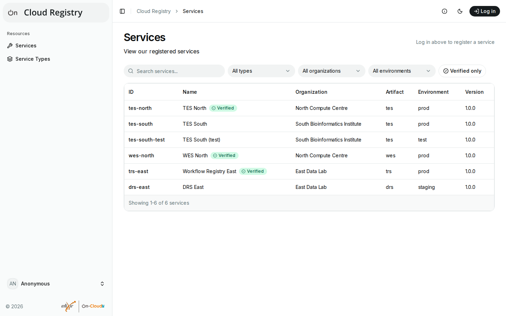
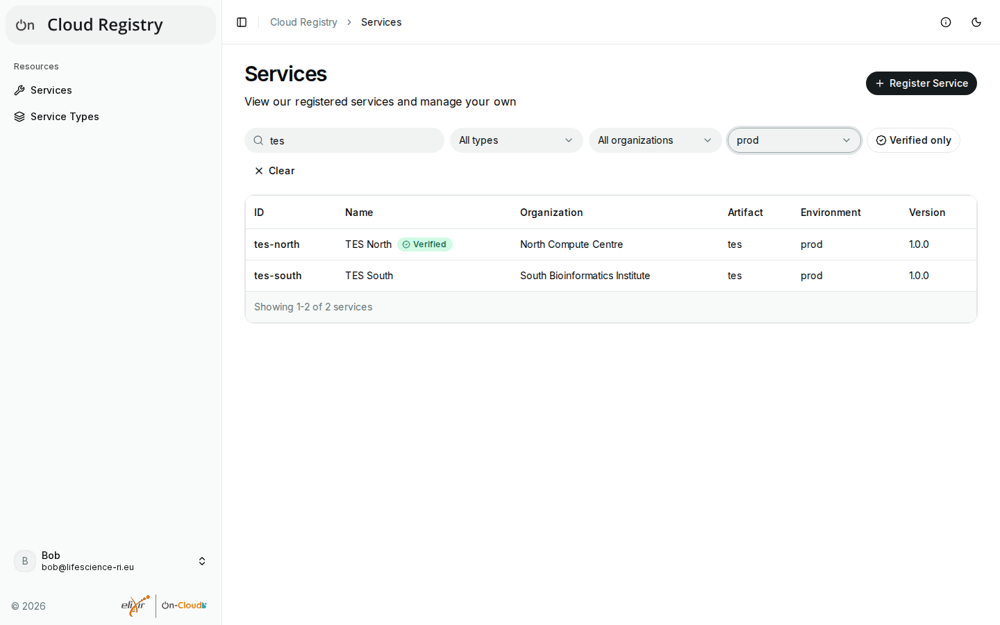
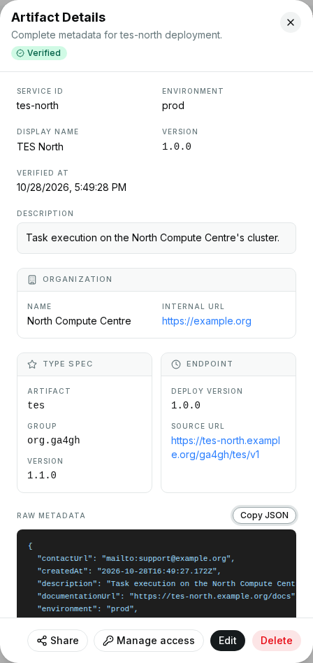
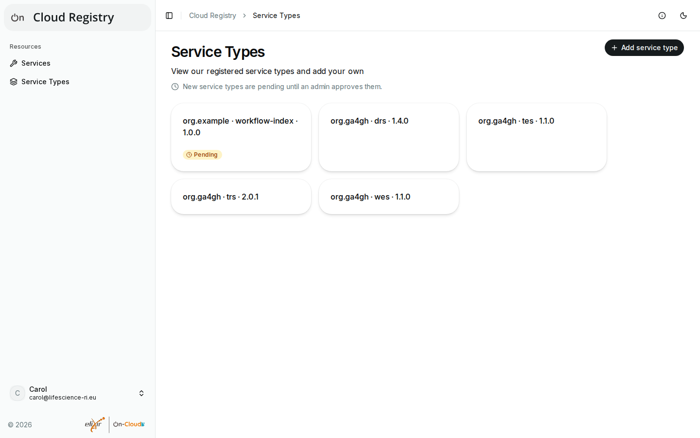
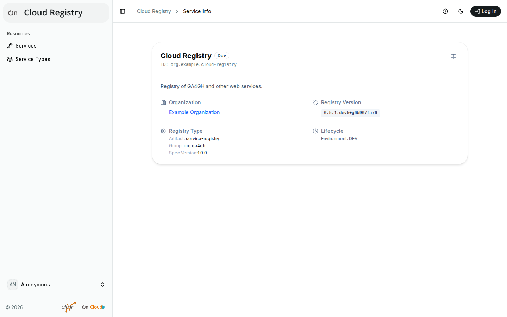

# Browsing and searching

## Services

**Services** in the sidebar lists the registered services, ten per page,
with their ID, name, organization, API (artifact), environment and version.
A **Verified** badge marks services that an admin has checked (see
[Verifications](verifications.md)); a **Pending** badge marks services that
await an admin's approval (see [Pending entries](pending.md)), which only
admins and users with a role on them see.

### Searching and filtering

Above the list:

- **Search services** finds services whose name, ID, description,
  organization, API, environment, version or URL contains the text, ignoring
  case.
- **All types**, **All organizations** and **All environments** show only
  services with the chosen value; **Not set** shows those without one.
- **Verified only** shows only verified services.
- **Pending only** (admins) shows only pending services.
- **Clear** resets the search and all filters.

The filters combine: e.g. search for "tes" and choose the environment
`prod` to find the production TES services.

### Details of a service

Select a service in the list to see its details: its ID, name,
environment and version, the description, the organization, the API
(type), the service's URL, when it was verified, and all its metadata as
JSON, e.g. with the contact and documentation URLs (**Copy JSON** copies
it).

{ width="448" }

The buttons below the details depend on your rights (see [Access and
permissions](access.md)):

- **Share** copies a link to the service's own page, e.g. to send it to
  others. If the browser can't copy it, the link is shown below the buttons.
- **Edit**, **Delete** and **Manage access** for owners, maintainers and
  admins (see [Registering and editing
  services](registering.md#editing-a-service)).
- **Verify** and **Approve** for admins in admin mode.

Each service also has its own page, which shows the same details:
`/dashboard/services/view/<ID>` of the app. If a service doesn't exist, or
you may not see it (e.g. while it awaits approval), the page says so.

## Service types

**Service Types** in the sidebar lists the service types of the registry:
the APIs that services can implement, each as group, artifact and version,
e.g. `org.ga4gh · tes · 1.1.0`. Services are registered with one of them.

If you may add service types (the registry decides who may), the page shows
**Add service type**: enter the group (e.g. `org.ga4gh`), the artifact
(e.g. `wes`) and the version (e.g. `1.1.0`), and select **Add**. In some
deployments, new types of users other than admins are pending until an
admin approves them; the page then says so (see [Pending
entries](pending.md)).

## Service info

The "i" icon in the top bar opens the registry's service info: the
registry's name, ID, description, organization, version, type and
environment, as the registry reports them.

