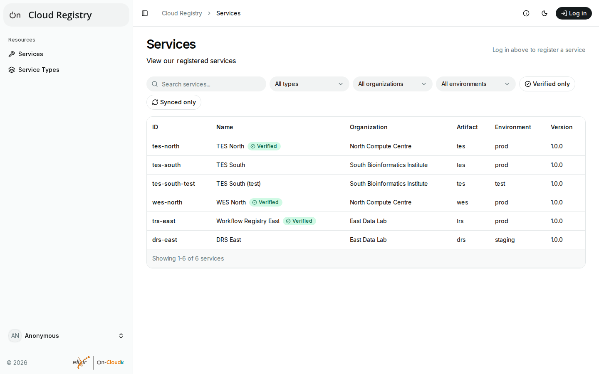
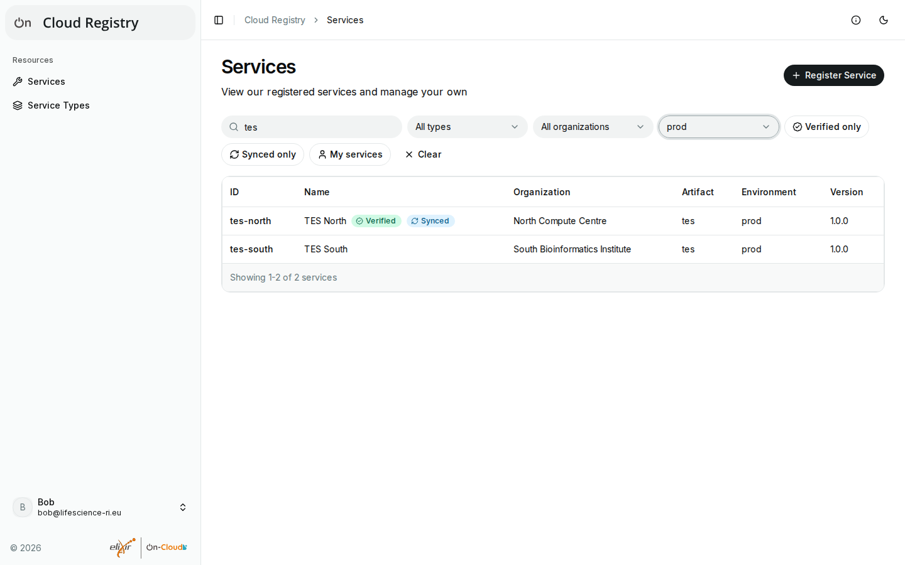
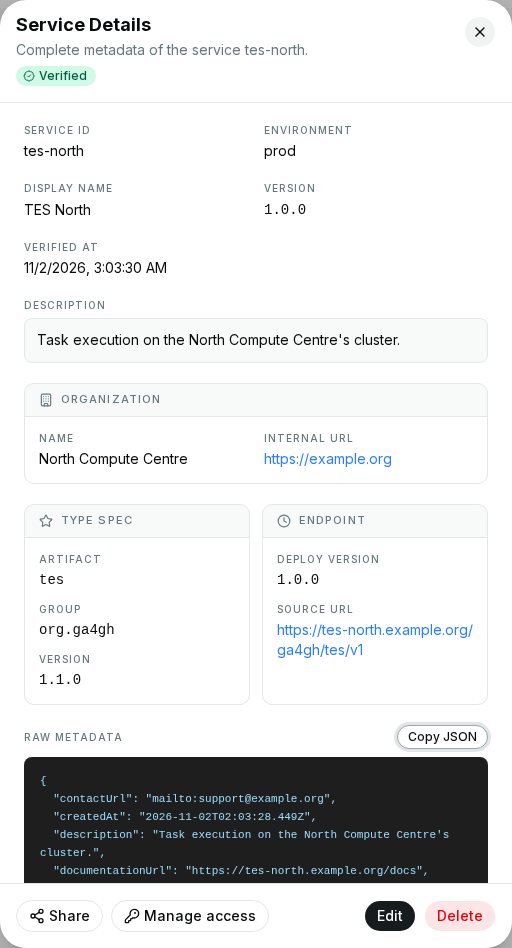
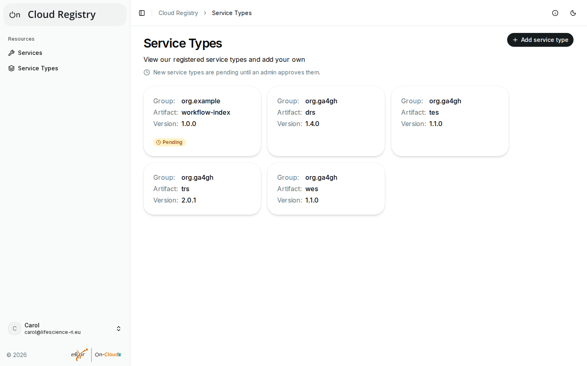
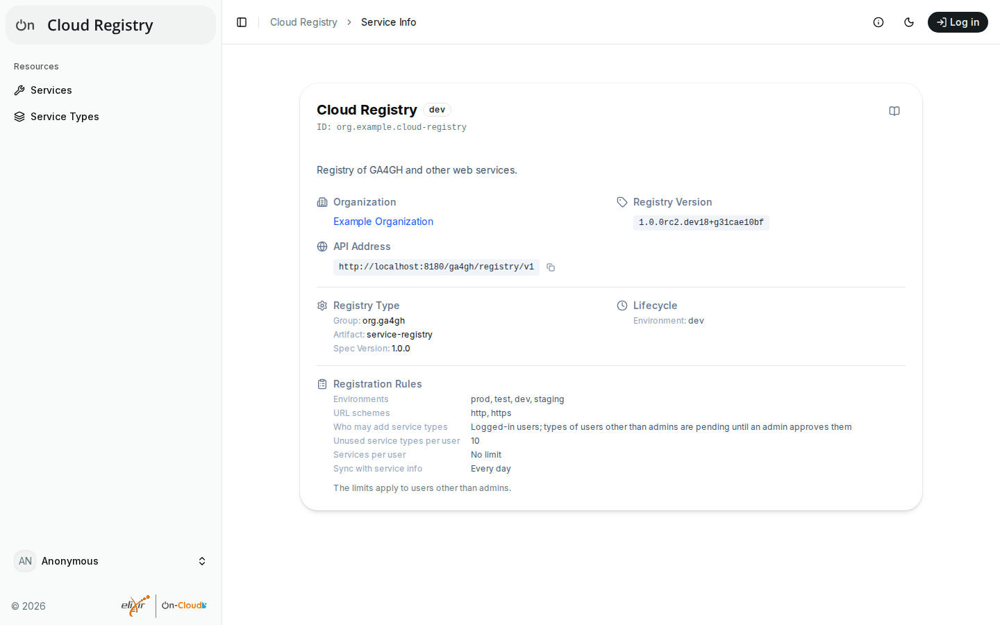

# Browsing and searching

## Services

**Services** in the sidebar lists the registered services, ten per page,
with their ID, name, organization, API (artifact), environment and version.
A **Verified** badge marks services that an admin has checked (see
[Verifications](verifications.md)); a **Pending** badge marks services that
await an admin's approval (see [Pending entries](pending.md)), which only
admins and users with a role on them see.

### Searching and filtering

Above the list:

- **Search services** finds services whose name, ID, description,
  organization, API, environment, version or URL contains the text, ignoring
  case.
- **All types**, **All organizations** and **All environments** show only
  services with the chosen value; **Not set** shows those without one.
- **Verified only** shows only verified services.
- **My services** (logged-in users) shows only the services you are
  responsible for: those on which you have a role, owner or maintainer,
  granted to you or to one of your groups (see [Access and
  permissions](access.md)).
- **Pending only** (admins) shows only pending services.
- **Clear** resets the search and all filters.

The filters combine: e.g. search for "tes" and choose the environment
`prod` to find the production TES services.

### Details of a service

Select a service in the list to see its details (**Service Details**): its
ID, name, environment and version, the description, the organization, the
API (type), the service's URL, when it was verified, and all its metadata
as JSON, e.g. with the contact and documentation URLs (**Copy JSON** copies
it). Long values, such as names, URLs and the JSON, wrap to the width of
the details, also on a phone.

{ width="512" }

The buttons below the details depend on your rights (see [Access and
permissions](access.md)). They come in two groups, which share a row
where they fit, and otherwise each take a row of their own:

- On the left, **Share** copies a link to the service's own page, e.g. to
  send it to others; if the browser can't copy it, the link is shown below
  the buttons. **Manage access** is there for owners and admins.
- On the right, the actions on the service itself: **Approve** (see
  [Pending entries](pending.md)) and **Verify** (see
  [Verifications](verifications.md)) for admins in admin mode, **Edit** for
  owners, maintainers and admins, and **Delete** for owners and admins (see
  [Registering and editing services](registering.md#editing-a-service)).

Each service also has its own page, which shows the same details:
`/dashboard/services/view/<ID>` of the app. If a service doesn't exist, or
you may not see it (e.g. while it awaits approval), the page says so.

## Service types

**Service Types** in the sidebar lists the service types of the registry:
the APIs that services can implement. Each tile shows a type's group,
artifact and version on lines of their own; lists to pick a type from (e.g.
in the service forms and filters) show them in one line, e.g.
`org.ga4gh · tes · 1.1.0`. Services are registered with one of them.

If you may add service types (the registry decides who may, see the
registration rules under [Service info](#service-info)), the page shows
**Add Service Type**: enter the group (e.g. `org.ga4gh`), the artifact
(e.g. `wes`) and the version (e.g. `1.1.0`), and select **Add**. In some
deployments, new types of users other than admins are pending until an
admin approves them; the page then says so (see [Pending
entries](pending.md)).

Registries limit how many service types that no service has each user
other than admins may have added; the dialog names the limit. Types count
until services have them or an admin removes them: register services with
your types, or ask an admin to remove those you don't need, before you add
others. If the limit is 0, only admins can add types, also by registering
services: the page then says so instead of offering **Add Service Type**
(admins who may switch to admin mode are asked to switch).

The page explains what went wrong if the registry refuses a type: it is
already registered (also if it is pending, and so not listed for you), you
have reached the limit of unused types, or, when an admin removes it,
services still have it (change or delete these services first).

## Service info

The "i" icon in the top bar opens the registry's service info: the
registry's name, ID, description, organization, version, type and
environment, as the registry reports them. If the registry names them, the
icons at the top right link to its documentation (**Documentation URL**)
and its contact (**Contact URL**).

**API Address** is the base URL of the registry's API that this app is
configured with, which may be on another host than the app. It's the address
your browser calls, and the one to use in scripts or other clients of the
API; the button next to it copies it. It's a base URL, not a page: the API's
calls add their paths to it, e.g. `/service-info`.
The page leaves it out if the app has no usable address configured.

Under **Registration Rules**, it shows the rules that the registry checks
for registrations:

- **Environments**: the environments that services may have; "Any" if the
  registry takes any value;
- **URL schemes**: the schemes that service URLs may have, e.g. `https`;
- **Who may add service types**: logged-in users, logged-in users with
  their new types pending until an admin approves them, or admins only
  (see [Service types](#service-types));
- **Unused service types per user**: how many service types that no
  service has each user may have added;
- **Services per user**: how many services each user may have registered
  (see [Limit on registered
  services](registering.md#limit-on-registered-services)).

The limits apply to users other than admins; 0 means that only admins add
types, or register services. Registries older than cloud-registry 1.0.0rc2
publish no rules under the name the app reads, and the page then leaves them
out.

In admin mode, the page also says whether the registry is listed among its
own services, and lets you change that (see [Listing the registry
itself](admin-mode.md#listing-the-registry-itself)).

