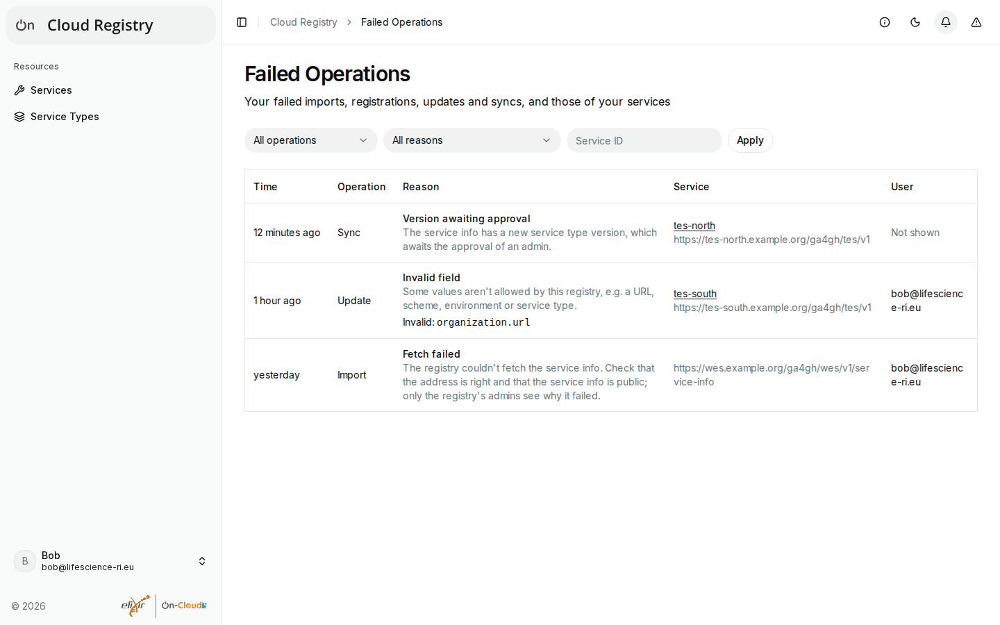

# Failed operations

When an import, registration, update or sync fails, the message on the page tells you
only about that one request, and syncs run without you. If you're logged in, the
triangle icon next to the [notification](notifications.md) bell leads to the list of
recent failures, so that you can find out why without access to the registry's logs.
So do **View failed operations** at the bottom of the list of notifications and
**Failed operations** in the menu at the bottom of the sidebar (your name), also on
narrow screens, such as phones, where the top bar has no room for the triangle:

## What you see

You see the failures of what you did yourself, and those of the services you have a
role on, also those of others and of the registry's own syncs. Admins in [admin
mode](admin-mode.md) see all failures.

Each row has:

- **Time:** when it failed (hover for the date and time).
- **Operation:** _Import_ (fetching a service info to fill in the form), _Registration_
  (a new service), _Update_ (changes of a service) or _Sync_ (with its service info,
  started by you or by the registry; see [Syncing services](syncing.md)).
- **Reason:** why, from a fixed set, explained in plain words, and the invalid fields,
  if any (e.g. `organization.url`). The registry never keeps values, answers of
  services or network errors.
- **Service:** the service's ID at the time, linked to its page, and its URL, if known.
- **User:** who acted, if you may see it: in admin mode, for all failures ("Registry"
  for the registry's own syncs); otherwise only for your own ("Not shown" for those of
  others).

The most recent come first. **Load more** shows older ones. The registry keeps
failures for a limited time, set by its operators (by default 30 days; see the
registry's [Failed operations](https://cloud-registry.readthedocs.io/en/latest/configuration/#failed-operations)
settings).

## Reasons

| Reason | What it means |
| --- | --- |
| Fetch failed | The registry couldn't fetch the service info of an import or of a sync that you started: check the address, and that the service info is public. Only admins see which of the two next reasons it was, so that nobody can probe networks through the registry |
| Unreachable | No answer in time, or an unusable one (e.g. a redirect, another status than 200, too large) |
| Address not allowed | The service's host resolves to an address that the registry may not fetch from, e.g. of a private network |
| Not JSON | The service info isn't JSON |
| Invalid service info | The service info doesn't pass the checks of a registration |
| Identity mismatch, Version awaiting approval, Version not allowed, Unused types limit reached | As for an out-of-sync service (see [Syncing services](syncing.md#the-details-of-a-service)) |
| Invalid field | Values that the registry doesn't allow, e.g. a URL, scheme, environment or service type; the row names the fields |
| Duplicate service | A service with the same URL and API type is registered already |
| Services limit reached | The user has registered as many services as the registry allows |
| Pending service | The service awaits approval (see [Pending entries](pending.md)) |
| URL locked by sync | The service syncs with its service info, so its URL can't change |

Requests that the registry rejects before its own checks (e.g. values of the wrong
type), conflicts of concurrent changes, too many requests in a short time and errors of
the registry itself aren't listed.

## Filters

Filter by operation, by reason and by service ID (type it, then **Apply**). **Failed
operations of this service** (the triangle at the top) in the details of a service you
have a role on opens the list for that service. The filters are part of the page's
address, so you can bookmark or share a filtered list; others see only what they may
see. **Clear filters** shows all again.

Registries without this list (up to cloud-registry 1.0.0rc2) say so on the page; so do
registries whose access policy refuses it (ask the registry's admins; see
[Compatibility](../operator-guide/index.md#compatibility)).
