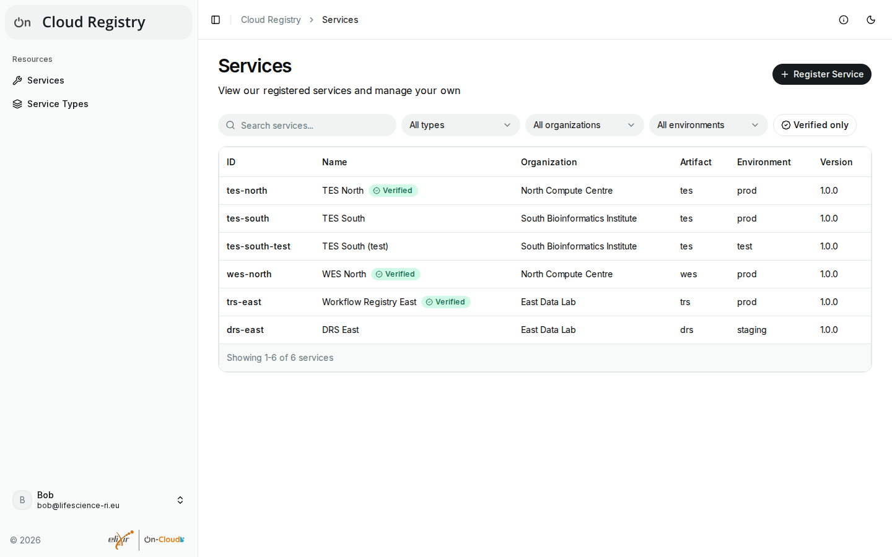
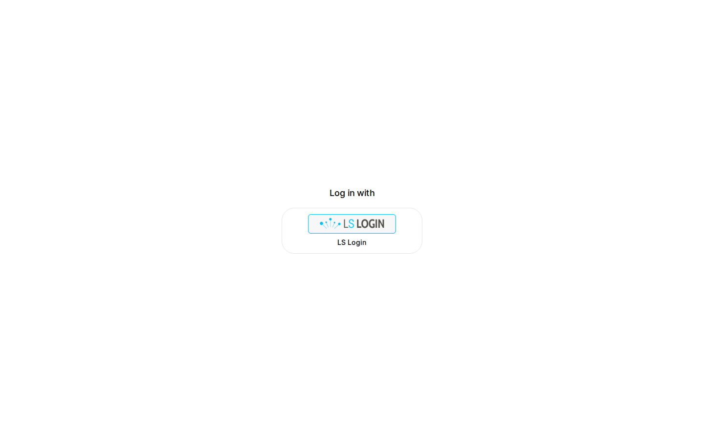
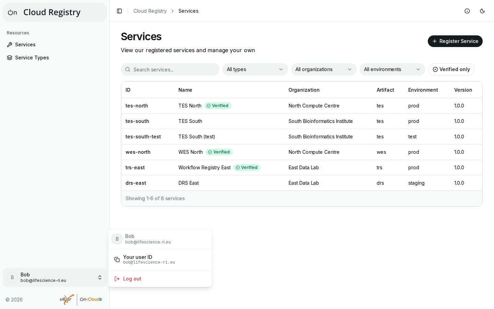

# User guide

This guide shows how to use the Cloud Registry UI: how to find services,
register and edit your own, give others access to them, and, for admins,
how to verify services and approve new service types.

!!! note "Your deployment may look different"

    The screenshots show the app in its default branding. Deployments can
    change the title and the logos, and may offer other login providers.
    Which login provider you use, which groups grant which rights, and whom
    to contact are described by your deployment, e.g. in the [ELIXIR Cloud
    documentation](https://elixir-cloud-aai.github.io/) for ELIXIR On-Cloud.
    What a deployment allows (e.g. the environments of services, or who may
    add service types) also depends on its registry, so some options
    described here may not be available to you.

## Pages

The sidebar on the left leads to the two lists of the registry:

- **Services**: the registered services, e.g. task execution (TES) or
  workflow execution (WES) services, with their address and organization
  (see [Browsing and searching](browsing.md)).
- **Service Types**: the APIs that services can implement, e.g. `org.ga4gh ·
  tes · 1.1.0` (see [Service types](browsing.md#service-types)).

The top bar has these buttons, from left to right:

- the sidebar button, which collapses the sidebar to icons and expands it
  again;
- the path of the current page, e.g. "Cloud Registry > Services";
- **Service Info** (the "i" icon): what the registry tells about itself,
  e.g. its organization, version and type;
- the light and dark colour scheme;
- **Log in**, or, for admins, the switch between **User mode** and **Admin
  mode** (see [Admin mode](admin-mode.md)).

## Logging in

You can browse the registry without logging in, unless your deployment
requires a login for that. To register services and to manage your own,
log in:

1. Select **Log in** in the top bar.
2. Choose your login provider, e.g. LS Login, and log in there.
3. You return to the app, logged in. Your name and email address are shown
   at the bottom of the sidebar.

Your session lasts as long as your login provider allows, at most 12
hours. Afterwards, pages show **Log in again**; changes you haven't saved
can't be sent until you log in again.

To log out, open the menu at the bottom of the sidebar (your name) and
select **Log out**.

### Your user ID

Owners of services give others access by their user ID (see [Access and
permissions](access.md)). To find yours, open the menu at the bottom of the
sidebar: **Your user ID** shows it, and selecting it copies it.

