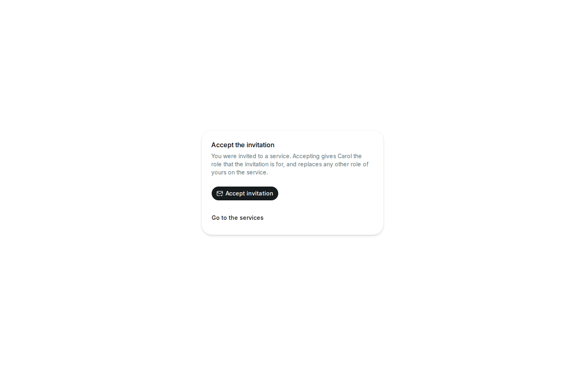

# Accepting an invitation

An owner of a service can invite you to it with a link (see [Inviting by
link](access.md#inviting-by-link)). The link looks like
`https://<app address>/invitations#<code>`. To accept it:

1. Open the whole link, including the code at the end. If the page says
   that there is no invitation, the code is missing: copy the link again.
2. If you are not logged in, log in. The app brings you back to the
   invitation afterwards, in the same browser tab. If the page then says
   that there is no invitation (e.g. because your browser blocks the
   storage that keeps the code during the login), open the link you were
   sent again.
3. Select **Accept invitation**. Accepting gives your account the role the
   invitation is for, and **replaces any other role of yours on the
   service**.
4. Select **View service** to open the service. It is in your services from
   now on.

{ width="672" }

The code is kept out of the address bar and the history once the page is
open, so don't rely on the address to open the invitation again: use the
link you were sent.

## Messages

| Message                                                   | Meaning and what to do |
| --------------------------------------------------------- | ---------------------- |
| This invitation doesn't exist, was revoked or has expired | The link no longer works. Ask the owner of the service for a new one. Registries older than cloud-registry 1.0.0-rc1 may also answer this way, as they don't know invitations: if new links never work, ask your registry's admins. |
| This invitation was accepted already                      | A link works once. If you accepted it, the service is in your services; otherwise ask the owner for a new link. |
| You are the last owner of this service, so this invitation can't change your role | The invitation would make you a maintainer of a service that you own alone. Grant another owner first. |
| This registry has no invitations                          | The registry doesn't support invitations (it is older than cloud-registry 1.0.0-rc1). Ask the owner to grant you the role directly (see [Managing access](access.md#managing-access)). |
| Your session expired                                      | Log in again; the invitation stays. |
| Your account can't accept invitations (with a reason)     | The registry refuses your account; the message says why. Ask your registry's admins. |
| You can't accept invitations                              | The registry denies your account the right to accept invitations. Trying again doesn't help: ask your registry's admins. |

Other failures are temporary: try again later.
