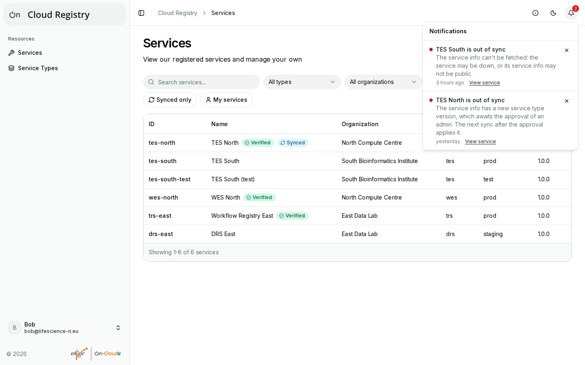

# Notifications

If you're logged in, the bell in the top bar shows what needs your attention, with a red
number if anything does:

## What you get

Everyone sees the notifications of the services they have a role on. Admins in [admin
mode](admin-mode.md) see those of all services, and those only admins can act on:

| Notification | Who sees it | What to do |
| --- | --- | --- |
| A service is out of sync | Those with a role on it, admins | See the reason in the notification, and [Syncing services](syncing.md#the-details-of-a-service) |
| A service type awaits approval | Admins | Approve or remove it (see [Pending entries](pending.md)) |
| A service awaits approval | Admins | Approve its service type (see [Pending entries](pending.md)) |
| A service has an environment that isn't allowed | Admins | Change the environment; until then, the service can't be updated |
| A service has a URL scheme that isn't allowed | Admins | Change the URL; until then, the service can't be updated |

The texts are fixed: the registry doesn't pass on network errors. Where there's a view to
fix a problem, a link in the notification leads there.

The list updates every minute while the page is visible.

## Dismissing a notification

**X** dismisses a notification, not only for you: for all with a role on the service, or,
in admin mode, for all admins, but not for each other. It comes back if the problem ended
and came back, or if its reason changed. Dismissing doesn't fix anything: a service stays
out of sync, and its label stays, until the cause is gone.

Registries older than 1.0.0rc2 have no notifications, and the app then shows no bell.
