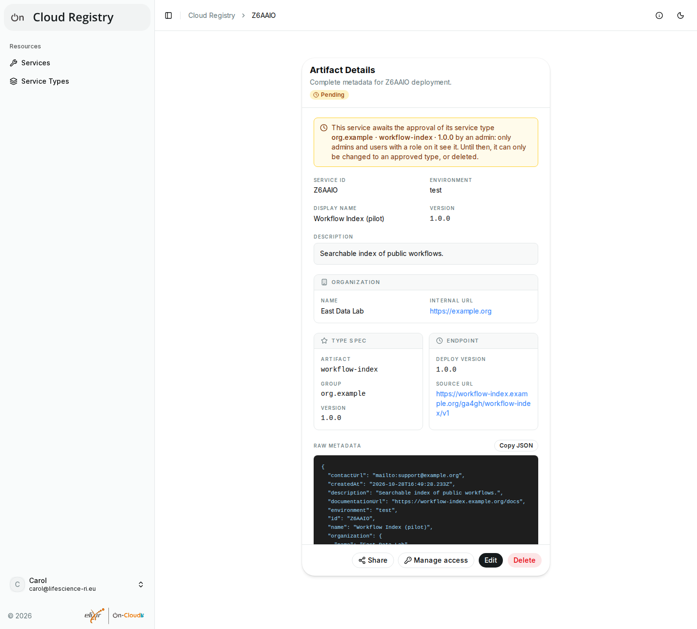
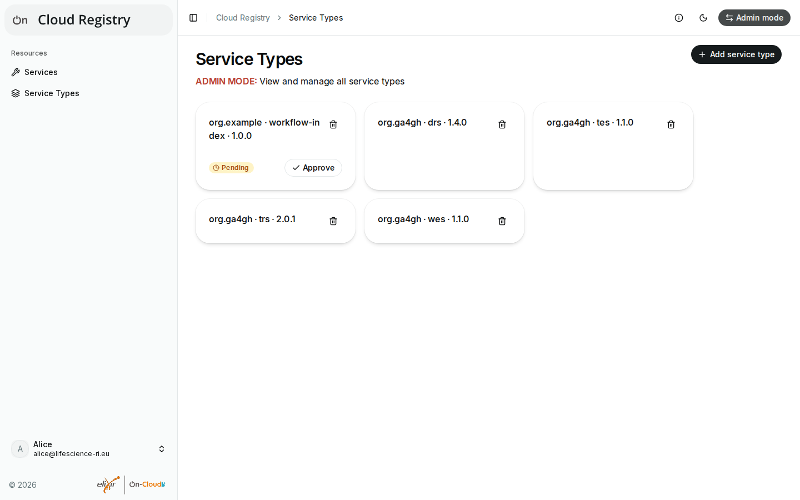

# Pending entries

In some deployments, new service types of users other than admins are
**pending** until an admin approves them, and so are the services that
have them, also those of other users. The **Service Types** page then says
"New service types are pending until an admin approves them". Types that
admins add are approved at once.

Pending entries are only visible to admins and to the users who added
them (for services: the users with a role on them). They have a
**Pending** badge, and the details of pending services explain why.

## While a service is pending

Until an admin approves its type, a pending service can only be:

- changed to an approved type (by its owners and maintainers), which makes
  it visible to everyone;
- deleted (by its owners).

Pending services can't be verified, and services that become pending lose
their verification (see [Verifications](verifications.md)).

Once the type is approved, the type and all services that have it are
listed for everyone. If you need a new type approved, ask the admins of
your deployment.

## Approving service types (admins)

In [admin mode](admin-mode.md), admins see all pending types and services:

- **Service Types** shows **Approve** on each pending type.
- **Services** shows the pending services with a **Pending** badge;
  **Pending only** shows only them. Their details have **Approve**, which
  approves their type.

**Approve** asks for confirmation first: approving a type lists it, and
all services that have it, for everyone, and can't be undone. To refuse a
type, ask the users to change their services to another type, or delete
the services, then remove the type (the bin icon on **Service Types**;
types that services still have can't be removed).
