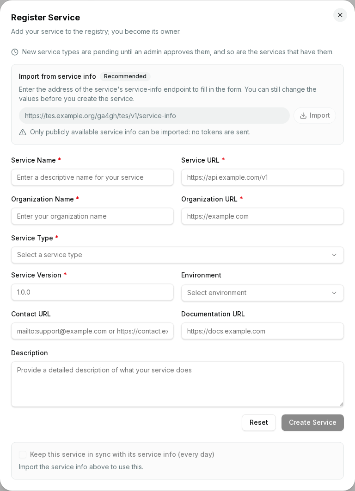
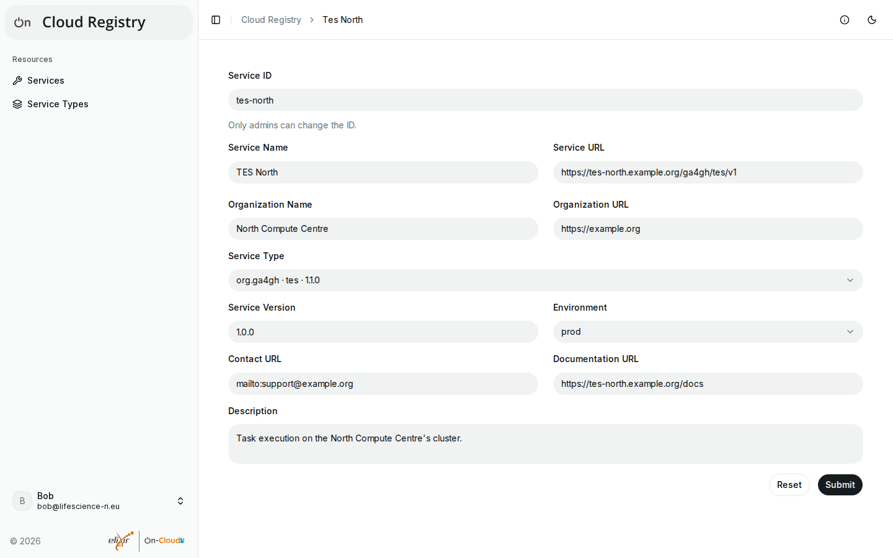

# Registering and editing services

Any logged-in user can register services, and becomes their **owner**.
Owners can edit and delete them, and give others access (see [Access and
permissions](access.md)).

## Registering a service

1. Log in, open **Services** and select **Register Service**.
2. Fill in the form:
    - **Service Name**: a descriptive name, e.g. "TES North".
    - **Service URL**: the base URL of the service's API, e.g.
      `https://tes.example.org/ga4gh/tes/v1`. Most deployments accept only
      `https` URLs.
    - **Organization Name** and **Organization URL**: who runs the service.
    - **Service Type**: the API that the service implements, chosen from
      the registered types, e.g. `org.ga4gh · tes · 1.1.0` (see [Service
      types](browsing.md#service-types)). If none fits and you may add
      types, choose **Add new service type** and enter its **Type Group**,
      **Type Artifact** and **Type Version**, e.g. `org.ga4gh`, `tes` and
      `1.1.0`.
    - **Service Version**: the version of the service's software.
    - **Environment**: one of those that the deployment allows, e.g.
      **Production** (`prod`) or **Test** (`test`); a text field if it
      allows any.
    - **Contact URL** (e.g. `mailto:support@example.org`) and
      **Documentation URL**.
    - **Description**: what the service offers, and to whom.
3. Select **Create Service**. A message confirms the registration, with a
   link to the new service (**View service**). **Reset** empties the form.

If you leave the page with unsaved input, the app asks first.

The registry gives the service an ID. Admins in admin mode (see [Admin
mode](admin-mode.md)) also see **Advanced Configuration**, where they can
choose the ID (**Custom Service ID**) and set the dates (**Created At**,
**Updated At**); for other users, the registry sets them.

The registry checks the entries: e.g. a service with the same URL and type
as a registered one is refused as a duplicate, and the message links to that
service if you may see it. If it refuses a registration, the message says
why; correct the entry and try again.

A new type is added with the service. In some deployments, new types of
users other than admins are pending until an admin approves them, and so are
the services that have them (see [Pending entries](pending.md)); the form
says so above its fields. If you may not add types, the form offers only the
registered ones.

### Known limitations

The form comes from [Cloud
Components](https://github.com/elixir-cloud-aai/cloud-components). It checks
only that the required fields are filled in; other mistakes, e.g. an invalid
URL, are reported by the registry after sending
([cloud-components#453](https://github.com/elixir-cloud-aai/cloud-components/issues/453)).

## Limit on registered services

A registry can limit how many services each user may register. At the
limit, the app doesn't register another service and says: "You have
registered as many services as this registry allows (N)", with the number
of services allowed. Delete a service you no longer need, or ask the
registry's admins.

The limit is set by the registry (`custom.access_control.max_services_per_user`,
50 by default) and published in its service info
(`registration_rules.max_services_per_user`). If it is 0, only admins can
register services; an admin who is not in admin mode is told to switch to
admin mode first (see [Admin mode](admin-mode.md)). Registries older than
cloud-registry 1.0.0rc1 have no limit.

## Editing a service

Owners and maintainers of a service, and admins, can edit it:

1. Open the service (from the list, or its page) and select **Edit**.
2. Change the fields. The environment is chosen from those that the
   deployment allows.
3. Select **Submit**. **Reset** undoes your changes.

If you leave the page with unsaved changes, the app asks first.

Some changes have consequences:

- **URL or API:** changing the URL, or the type's group or artifact,
  removes the service's verification (see
  [Verifications](verifications.md)); changing it back doesn't restore it.
- **New type:** a type that isn't registered yet is added, if you may add
  types; it may be pending until an admin approves it, and the service
  with it (the form says so).
- **Service ID:** only admins can change it. The service keeps its roles
  and its verification under the new ID, but links to the old ID stop
  working.

If the new URL and type are those of another registered service, the
registry refuses the change as a duplicate, and the message shows that
service.

## Deleting a service

Owners of a service, and admins, can delete it: open the service and
select **Delete**. The service is deleted at once, with its roles and its
verification, and can't be restored.
