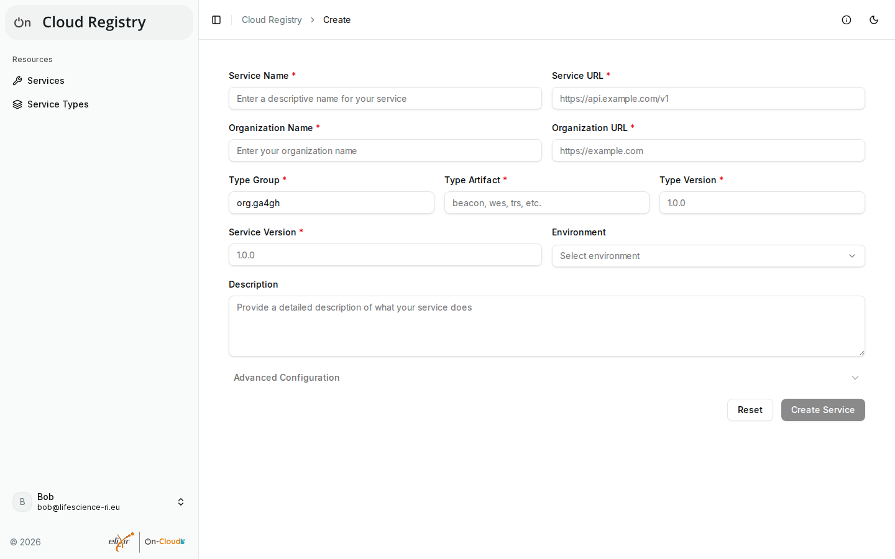
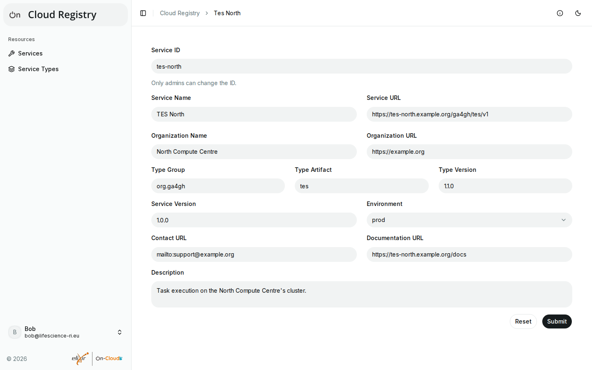

# Registering and editing services

Any logged-in user can register services, and becomes their **owner**.
Owners can edit and delete them, and give others access (see [Access and
permissions](access.md)).

## Registering a service

1. Log in, open **Services** and select **Register Service**.
2. Fill in the form:
    - **Service Name**: a descriptive name, e.g. "TES North".
    - **Service URL**: the base URL of the service's API, e.g.
      `https://tes.example.org/ga4gh/tes/v1`. Most deployments accept only
      `https` URLs.
    - **Organization Name** and **Organization URL**: who runs the service.
    - **Type Group**, **Type Artifact** and **Type Version**: the API that the
      service implements, e.g. `org.ga4gh`, `tes` and `1.1.0`. Use a type
      from **Service Types** where one fits (see [Service
      types](browsing.md#service-types)).
    - **Service Version**: the version of the service's software.
    - **Environment**: e.g. `prod` for production services, or `test`.
    - **Description**: what the service offers, and to whom.
    - **Advanced Configuration**: the contact URL (e.g.
      `mailto:support@example.org`) and the documentation URL.
3. Select **Create Service**. A message confirms the registration, with a
   link to the new service (**View service**).

The registry gives the service an ID. Only admins can choose IDs (in
**Advanced Configuration**); leave that field empty.

The registry checks the entries: e.g. a service with the same URL and type
as a registered one is refused as a duplicate, and some deployments allow
only some environments. If it refuses a registration, the message says why;
correct the entry and try again.

If the type isn't registered yet, registering the service adds it, if you
may add types. In some deployments, new types of users other than admins
are pending until an admin approves them, and so are the services that
have them (see [Pending entries](pending.md)).

### Known limitations

The form comes from [Cloud
Components](https://github.com/elixir-cloud-aai/cloud-components). Until it
supports the registry's newer features:

- **Environments:** the form offers only `prod`, `test`, `dev` and
  `staging`, also if the deployment allows others; the app refuses other
  values before sending them. Use the edit form afterwards for the
  deployment's other environments.
- **Service types:** the form asks for the type as free text, not as a
  choice from the registered types, and doesn't say when a new type will be
  pending (the **Service Types** page and the edit form do).
- **Service ID:** the form shows the field to all users, but only admins
  may fill it in.
- **Validation:** the form checks only that the required fields are
  filled in; other mistakes, e.g. an invalid URL, are reported by the
  registry after sending.
- **Layout:** the contact and documentation URLs are under **Advanced
  Configuration**.

## Editing a service

Owners and maintainers of a service, and admins, can edit it:

1. Open the service (from the list, or its page) and select **Edit**.
2. Change the fields. The environment is chosen from those that the
   deployment allows.
3. Select **Submit**. **Reset** undoes your changes.

If you leave the page with unsaved changes, the app asks first.

Some changes have consequences:

- **URL or API:** changing the URL, or the type's group or artifact,
  removes the service's verification (see
  [Verifications](verifications.md)); changing it back doesn't restore it.
- **New type:** a type that isn't registered yet is added, if you may add
  types; it may be pending until an admin approves it, and the service
  with it (the form says so).
- **Service ID:** only admins can change it. The service keeps its roles
  and its verification under the new ID, but links to the old ID stop
  working.

If the new URL and type are those of another registered service, the
registry refuses the change as a duplicate, and the message shows that
service.

## Deleting a service

Owners of a service, and admins, can delete it: open the service and
select **Delete**. The service is deleted at once, with its roles and its
verification, and can't be restored.
