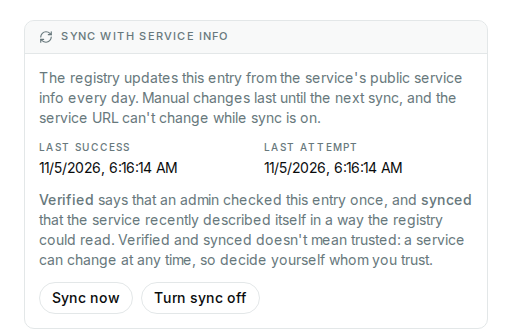

# Syncing services

The registry can keep a service's entry up to date with the service's own
[service info](https://cloud-registry.readthedocs.io/en/latest/api/#synced-services):
it fetches it regularly, as the deployment sets, and updates the entry. Entries
without sync can drift from what the service says about itself. Deployments that
don't sync show none of this.

## What the labels mean

Next to the **Verified** mark, in the list and in the details of a service, the
registry's label says how the sync stands:

- **no label**: no sync, e.g. a manual entry, which may have drifted. If the state
  couldn't be read, the app says so instead;
- **Synced**: the last sync succeeded, and it was recent;
- **Out of sync**: the last sync failed, or none succeeded in time. The entry keeps
  its last values.

**Verified and synced doesn't mean trusted.** Verified says that an admin checked this
entry once, and synced that the service recently described itself in a way the registry
could read. Both are facts about the entry, not about the service: service info is
self-declared, and a service can change at any time. Decide yourself whom you trust.

**Synced only**, above the list, shows only services in sync, and repeats that this
doesn't mean trusted. To be on the safe side, use it together with **Verified only**.

## The details of a service

**Sync with service info**, in a service's details, shows the times of the last
success and the last attempt and, if the service is out of sync, why:

{ width="512" }

| Message | What to do |
| --- | --- |
| The service info can't be fetched | Check that the service is up, and that its service info is public: no tokens are sent. The registry retries a few times before the label changes |
| The host resolves to an address that the registry may not fetch from | Ask the registry's operators, if the service is in a private network |
| The service info doesn't pass the checks of a registration | Correct the service info, e.g. an environment that the registry doesn't allow |
| The service info now describes another service | Something is seriously wrong: its `id`, or the group or artifact of its type, changed. If the new `id` is right, turn sync off and on again |
| A new service type version awaits approval | Wait for an admin to approve it (see [Pending entries](pending.md)); the next sync applies it |
| A service type version isn't registered, and only admins may add it | Ask the admins to add it |
| The registrant has added as many unused service types as allowed | Remove types no service needs, or ask an admin |
| The registry hasn't synced this service in time | Nothing failed, but syncs may not be running: tell the registry's operators |

These texts are fixed: the registry doesn't pass on network errors. Those with a role
on the service also get a [notification](notifications.md).

## Turning sync on and off

Owners and maintainers of a service, and admins in [admin mode](admin-mode.md), have
these buttons in its details:

- **Turn sync on**, after a confirmation: the registry fetches the service info from the
  service's URL followed by `/service-info`, and replaces the entry's values with it,
  overriding manual changes. If the fetch fails, or the service info doesn't fit the
  service, nothing changes and the app says so.
- **Sync now**: syncs at once, unless someone turned sync off since the page loaded: then
  it does nothing, and says so. A service info that can't be applied shows as **Out of
  sync**, with the reason. If the fetch fails, or the service info describes another
  service, nothing changes and the app says so; the regular syncs record these as
  reasons.
- **Turn sync off**: the entry keeps its values.

Only publicly available service info can be synced, as no tokens are sent. If service
info was fetched too often, the app says how long to wait.

## Changes while sync is on

You can edit a synced service, but the next sync overrides the fields it covers: name,
type, description, organization, contact and documentation URLs, environment and
version. Its ID, URL and roles stay. A sync also keeps the **Verified** mark.

The **Service URL** can't change while sync is on, not even for admins: the edit form
says so if you change it, and the registry refuses it. To move a service, turn sync off
first, or import and register it anew.
