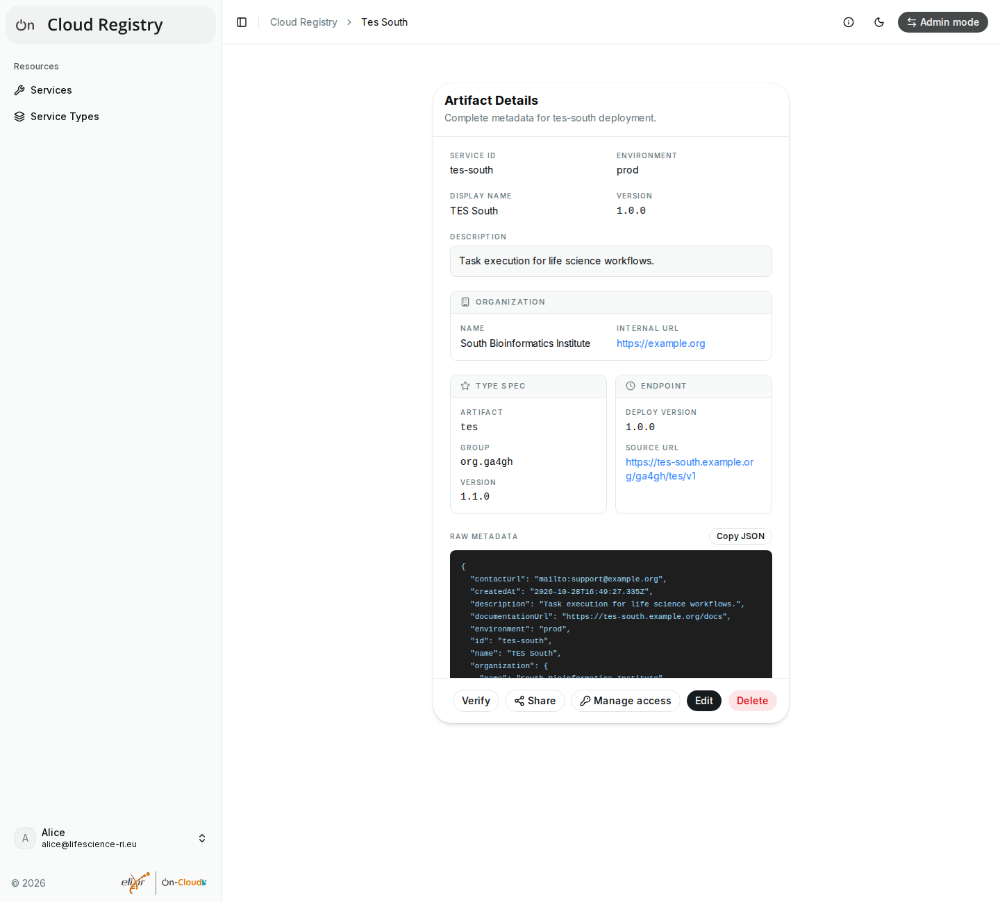

# Verifications

Admins mark services as **verified** once they have checked them. What
they check is up to each deployment, e.g. that a service is reachable and
accepts the deployment's logins; your deployment's documentation may say
more. Verified services have a **Verified** badge in the list and in their
details, which also show when they were verified. **Verified only** above
the list shows only them.

Clients can rely on verifications, e.g. a gateway that sends tasks only to
verified TES services: they apply to the service as it was checked.

## When verifications are removed

A verification applies to the URL and API that the admin checked:

- Changing the service's URL (even only its spelling, e.g. a trailing
  slash), or the group or artifact of its type, removes the verification.
  Changing them back doesn't restore it; ask an admin to verify the service
  again.
- Other changes, e.g. of the name, the version or the type's version, keep
  it.
- Services that become pending (e.g. by changing to a new type that awaits
  approval) lose their verification.
- Deleting a service deletes its verification.

## Verifying services (admins)

In [admin mode](admin-mode.md), admins see **Verify** below the details of
services that aren't verified, and **Unverify** below those that are:

1. Check the service, as your deployment requires.
2. Open the service and select **Verify**.

The app sends the URL and API that it showed you, so the registry verifies
the service only if nobody changed them meanwhile; otherwise, it asks you
to check the service again.

Pending services can't be verified: approve their type first (see [Pending
entries](pending.md)).
